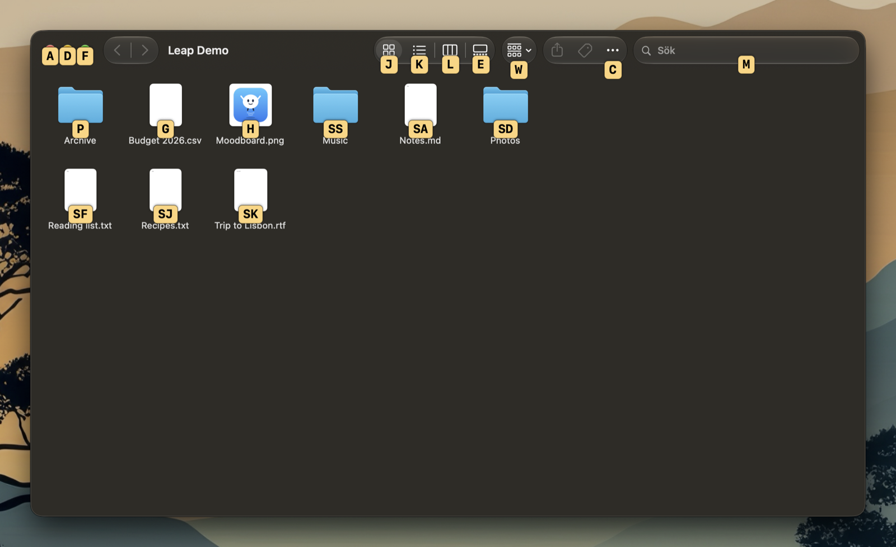
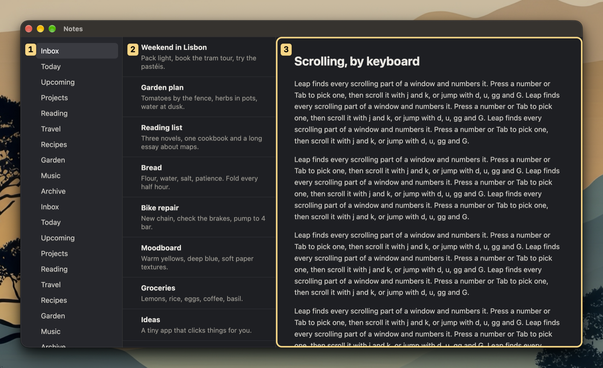
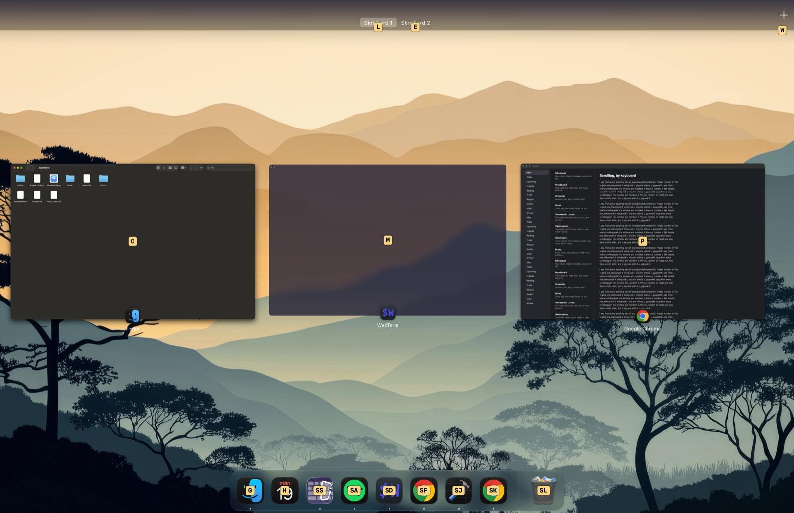

# Leap

Click anything on your Mac with the keyboard. Press a shortcut, labels appear on
everything you can click, and typing a label clicks it. Works in apps, browsers, the
menu bar, notifications and Mission Control.

I built Leap for myself, mostly for everything outside the browser; in the browser I
mostly use Vimium. It does what I have needed so far, so it may be missing something you
need. Bugs and ideas are welcome as [issues](https://github.com/niklascarlsen/leap/issues).

Needs macOS 27 or later.

## Install

```sh
brew install --cask niklascarlsen/tap/leap
```

Or download the zip from the [latest release](https://github.com/niklascarlsen/leap/releases/latest),
unzip it and move Leap to Applications.

When Leap starts the first time, macOS asks you to give it Accessibility access (System
Settings > Privacy & Security > Accessibility). Turn it on and Leap works right away. It
needs that access to see and click what is on screen. Nothing leaves your Mac.

## Use

Pressing a shortcut again closes it. The menu bar icon has the same commands.

### Leap

`⇧⌘Space`: labels appear on everything you can click in the app in front, in the
menu bar and on notifications. Type a label to click it.

- Shift on the last letter right-clicks, or closes a notification.
- Backspace takes back a letter, Escape closes the labels.



### Scroll

`⇧⌘J`: scroll the window in front without the mouse.

- `j` / `k` scroll down / up and `h` / `l` left / right while you hold them. Add Shift
  to go faster.
- `d` / `u` jump half a page down / up, `gg` / `G` to the top / bottom.
- In a window with several scrolling parts, `1`-`9` or Tab picks one.
- Escape stops.



### Mission Control

Opening Mission Control shows labels on its windows, desktops and the Dock. Shift on the
last letter of a desktop's label closes that desktop.



## Settings

Open Settings from the menu bar icon. There you change both shortcuts, the keys labels
are made of, the size and colors of the labels, the color of the scroll border, whether
Leap opens at login, and whether labels appear in Mission Control.

Any shortcut works: click one in Settings and press the keys. That includes a Hyper key
(⌃⌥⇧⌘ from Karabiner-Elements, Raycast or similar) or a single F13-F19 key.

## Build from source

Needs Xcode 27.

```sh
swift test
scripts/build-app.sh --install
```

This builds Leap and installs it to `~/Applications`. It stops if Leap is also
installed in `/Applications`, since two copies would compete for the shortcuts; remove
that one first (`brew uninstall --cask leap` keeps your settings). The script signs
Leap with a Developer ID or Apple Development identity from your keychain. Without one
it signs ad hoc, and macOS asks for Accessibility access again after every build.

## License

MIT
